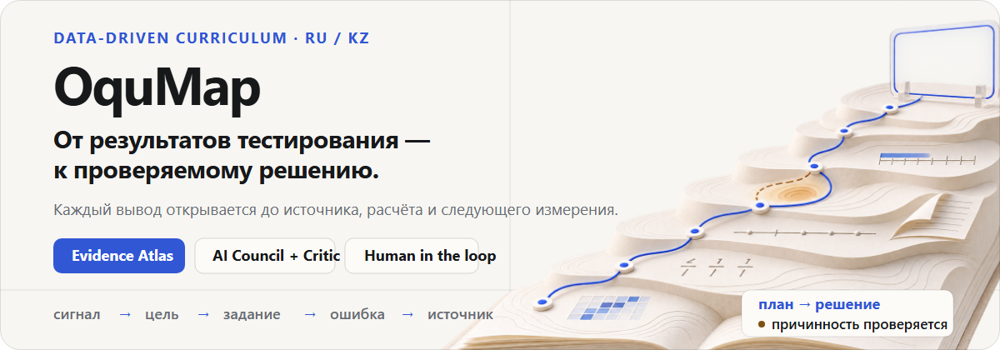
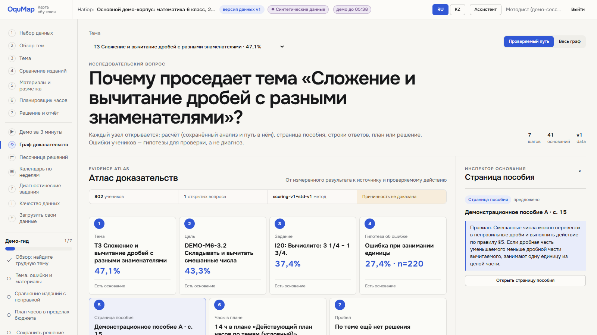
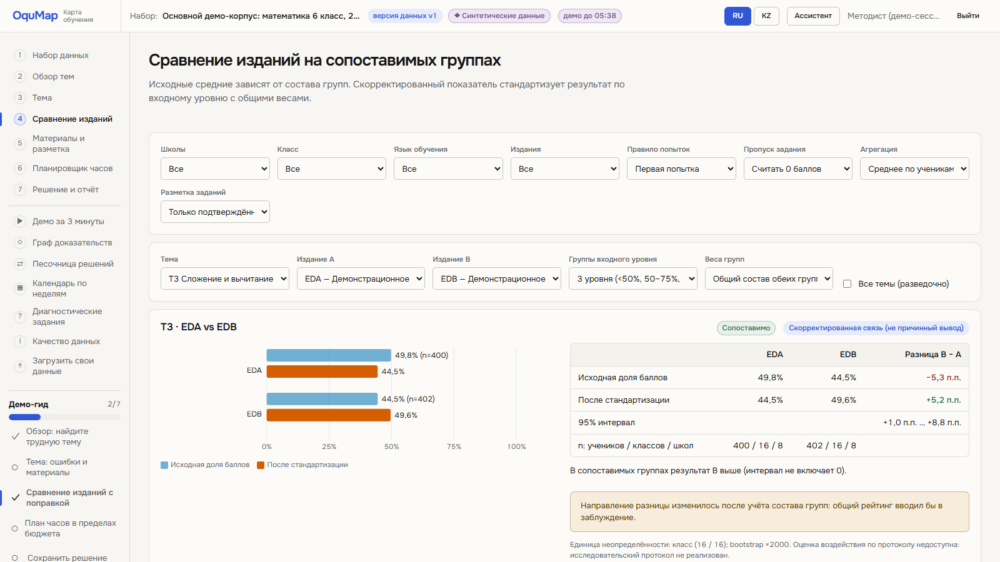
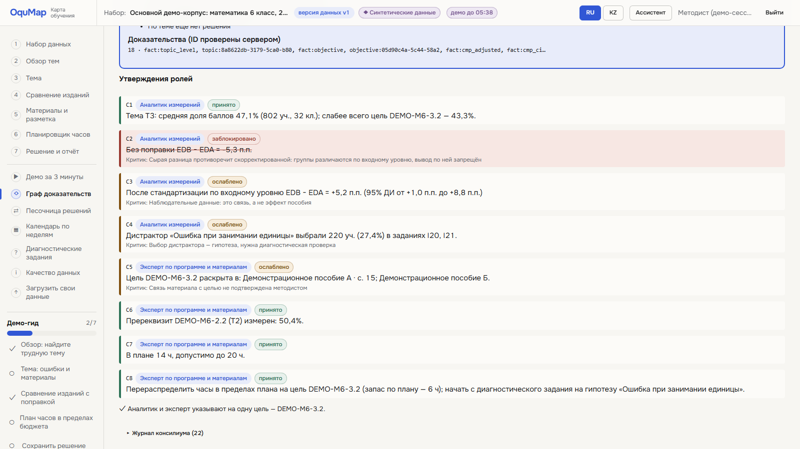
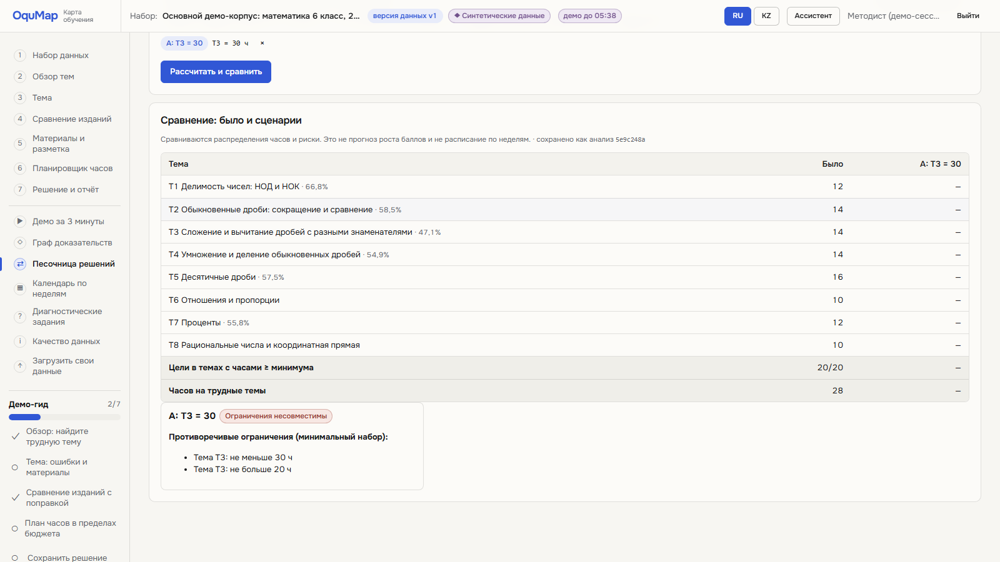
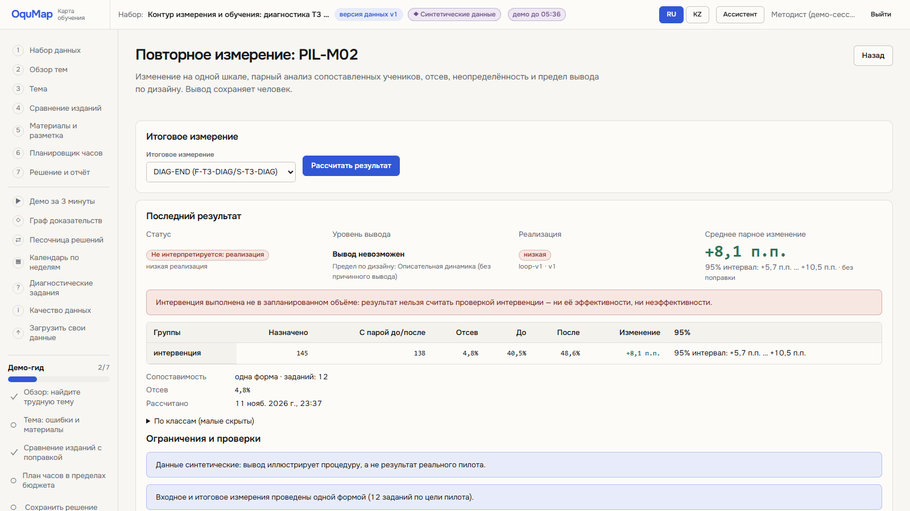
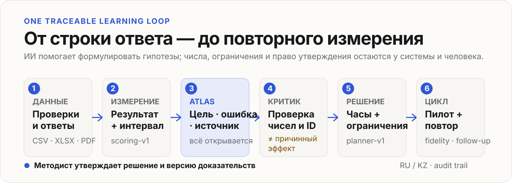

<p align="center">
  
</p>

<p align="center">
  <strong>Data-Driven Curriculum для методистов:</strong><br>
  OquMap связывает результаты тестирования, цели программы, задания, ошибки учеников, страницы пособий и бюджет часов в одно проверяемое решение.
</p>

<p align="center">
  <a href="#демо-за-3-минуты"><strong>Демо за 3 минуты</strong></a>
  &nbsp;·&nbsp;
  <a href="#запуск-одной-командой"><strong>Запустить локально</strong></a>
  &nbsp;·&nbsp;
  <a href="docs/METHODOLOGY.md"><strong>Методика</strong></a>
  &nbsp;·&nbsp;
  <a href="docs/API.md"><strong>API</strong></a>
</p>

> Все ученики, школы, пособия и результаты в публичном демо вымышлены. Демо-корпус воспроизводим и создаётся с фиксированным seed; он показывает работу системы, а не результаты реального пилота.

## Не ещё один дашборд

Обычный отчёт останавливается на «сложение и вычитание дробей = 47,1%». OquMap продолжает путь до ответа на три вопроса методиста:

1. **Что именно просело?** Тема раскрывается до цели программы, задания и проверяемой гипотезы ошибки.
2. **Почему этому можно доверять?** Каждый вывод ведёт к расчёту, строкам ответов, странице пособия или версии плана.
3. **Что допустимо изменить?** Система проверяет сравнимость групп, бюджет часов и качество реализации пилота до того, как сформулировать решение.

## Атлас доказательств

<p align="center">
  
</p>

Маршрут демо открывается узел за узлом:

`Тема: дроби · 47,1%` → `Цель: смешанные числа · 43,3%` → `Задание: 3¼ − 1¾ · 37,4%` → `Ошибка при занимании единицы · 27,4%, n=220` → `Пособие A · с. 15` → `14 часов` → `решения пока нет`

Каждый узел является ссылкой на основание. Пробелы не маскируются: если решения или надёжного измерения нет, OquMap показывает это как отдельный факт.

<table>
  <tr>
    <td width="50%"></td>
    <td width="50%"></td>
  </tr>
  <tr>
    <td><strong>Сырая разница меняет знак.</strong><br>B − A: −5,3 п.п. до поправки и +5,2 п.п. после стандартизации по входному уровню. OquMap не выдаёт связь за причинный эффект.</td>
    <td><strong>Модель предлагает формулировку. Сервер проверяет факты.</strong><br>Критик блокирует неизвестные числа, ID и вывод по сырой разнице, если поправка меняет направление.</td>
  </tr>
</table>

<table>
  <tr>
    <td width="50%"></td>
    <td width="50%"></td>
  </tr>
  <tr>
    <td><strong>Ограничения важнее красивого совета.</strong><br>Трудная тема получает `14 → 16` часов, донорская тема — `12 → 10`; баланс проходит независимую проверку. Запрос «30 часов на одну тему» возвращает конфликт с максимумом 20 часов, а не «тихо исправляется».</td>
    <td><strong>Решение закрывается повторным измерением.</strong><br>Версия интервенции, fidelity, проведение и новый замер сохраняются вместе. Низкая реализация останавливает вывод о методе.</td>
  </tr>
</table>

## Как работает OquMap

<p align="center">
  
</p>

- **Данные.** CSV/XLSX импортируются по этапам; отчёт качества показывает пропуски, попытки, покрытие целей и то, чего не хватает.
- **Измерение.** Доля набранных баллов, интервалы по классам и правила агрегации имеют явную версию метода.
- **Evidence Atlas.** Тема связывается с целью, заданием, гипотезой ошибки, источником, часами и сохранённым решением.
- **Критик.** Числа, идентификаторы и уровень доказательности проверяются сервером по фактам анализа и JSON Schema.
- **Решение.** CP-SAT и независимый валидатор проверяют бюджет, минимумы, максимумы, пререквизиты и закреплённые недели.
- **Проверка.** Пилот получает протокол, версию, fidelity и повторное измерение; результат остаётся наблюдаемой динамикой, пока дизайн исследования не позволяет больше.

## Демо за 3 минуты

После запуска нажмите **«Открыть демо»**, затем **«Демо за 3 минуты»**. Preflight сам проверит данные и готовность ключевых экранов.

| Шаг | Что показать жюри | Момент, который запоминается |
|---:|---|---|
| 1 | Обзор тем | «Сложение и вычитание дробей» — 47,1%, а темы без измерения не превращаются в 0% |
| 2 | Evidence Atlas | семь открываемых оснований и явный пробел «решения пока нет» |
| 3 | Сравнение изданий | −5,3 → +5,2 п.п. после поправки на входной уровень |
| 4 | AI Council | критик блокирует сырой вывод и разрешает осторожную формулировку |
| 5 | Песочница | допустимый перенос 2 часов и проверенный конфликт «30 часов на одну тему» |
| 6 | Диагностика | задания на найденные гипотезы, ключ и дистракторы с объяснением |
| 7 | Решение | версия, основания, ответственный и план повторного измерения |

Полная режиссура показа находится в [docs/DEMO_SCENARIO.md](docs/DEMO_SCENARIO.md).

## Запуск одной командой

```bash
docker compose up --build
```

Откройте [http://localhost:8080](http://localhost:8080) и нажмите **«Открыть демо»**. При первом старте OquMap применит миграции, загрузит синтетический корпус и дождётся готовности API, БД, worker и web.

Сбросить демо до исходного состояния:

```bash
docker compose down -v
docker compose up --build
```

Публичный режим создаёт для каждого посетителя отдельную одноразовую организацию с TTL и фоновой очисткой. API доступен через web-прокси по `/api/v1`; его контракт хранится в [packages/contracts/openapi.json](packages/contracts/openapi.json).

<details>
<summary><strong>Разработка без Docker</strong></summary>

Требуется PostgreSQL 16, Python 3.11–3.13 с [uv](https://docs.astral.sh/uv/) и Node.js 20+.

```bash
cp .env.example .env
cd apps/api
uv sync
uv run alembic upgrade head
uv run python -m oqumap.demo.seed
uv run uvicorn oqumap.main:app --reload --port 8000
```

Во втором терминале:

```bash
cd apps/web
npm ci
npm run dev
```

Windows PowerShell: `powershell -ExecutionPolicy Bypass -File scripts\dev.ps1`  
Linux/macOS: `scripts/dev.sh`

</details>

## ИИ, которому не отдают право на цифры

OquMap полностью работает без API-ключа: аналитика, сравнение, планирование и критик от модели не зависят. LLM формулирует объяснение поверх типизированных серверных инструментов, а результат проходит проверку по JSON Schema и фактам сохранённого анализа.

Поддерживаются `gemini`, `openrouter`, `openai`, `anthropic`, записанный демо-ответ и режим без модели. Пример для Gemini на синтетических данных:

```env
OQUMAP_LLM_PROVIDER=gemini
OQUMAP_LLM_MODEL=gemini-3.8-flash
OQUMAP_LLM_FALLBACK_MODEL=gemini:gemini-3.5-flash-lite
OQUMAP_GEMINI_API_KEY=<server-only-key>
OQUMAP_LLM_REAL_DATA_ALLOWED=false
```

Ключ остаётся на сервере и не попадает во frontend, ответы API, экспорт, логи или базу. Анонимный public demo не вызывает живую модель. Проверить конфигурацию и возможности провайдера:

```bash
cd apps/api
uv run python -m oqumap.maintenance check-config
uv run python -m oqumap.maintenance probe-llm
```

## Проверяемость встроена в продукт

- одна голова миграций и прогон на чистой БД;
- одинаковый backend-набор на SQLite и PostgreSQL;
- contract drift для OpenAPI и сгенерированных TypeScript-типов;
- Vitest, Playwright и axe для RU/KZ сценариев;
- два холодных Docker-старта с пустыми томами, health checks, worker restart audit и E2E;
- `pip-audit` и `npm audit` в CI;
- PDF, CSV и XLSX проверяются по сохранённой версии решения;
- действия методиста, версии данных, метода и интервенции остаются в audit trail.

```bash
scripts/check.sh
scripts/docker_cold_start.sh 2 --e2e
```

## Демо-корпус для жюри

Отдельный воспроизводимый набор позволяет показать импорт и качество данных с нуля:

| Ученики | Классы | Школы | Задания | Ответы | Отклонено при импорте |
|---:|---:|---:|---:|---:|---:|
| 384 | 16 | 8 | 42 | 46 074 | 0 |

В набор входят CSV, XLSX, два PDF, манифест и проверки повторной генерации. Пилоты и fidelity подготовлены отдельными fixtures, чтобы наблюдаемая динамика не смешивалась с причинным эффектом.

## Архитектура

```text
данные → детерминированная аналитика → Evidence Atlas → критик → допустимый план → пилот → повторный замер
              │                         │
              └── версии и источники ───┴── audit trail
```

| Слой | Реализация |
|---|---|
| Web | React, TypeScript, Vite, RU/KZ, доступность |
| API | FastAPI, SQLAlchemy, Alembic, OpenAPI |
| Аналитика | сохранённые анализы, стандартизация, интервалы, typed tools |
| Планирование | CP-SAT + независимая проверка ограничений |
| AI | провайдер-независимые адаптеры, schema gate, deterministic critic |
| Runtime | PostgreSQL, worker, Docker Compose, readiness/selfcheck |

## Навигация по репозиторию

```text
apps/api/                  API, аналитика, импорт, ИИ, планирование, отчёты
apps/web/                  интерфейс, дизайн-система, RU/KZ, сценарии
packages/contracts/        зафиксированный OpenAPI-контракт
data/demo/                 встроенный демо-корпус и манифест
data/jury-demo-dataset/    воспроизводимый импортный набор для жюри
tests/e2e/                 сквозные, WOW, measurement и a11y сценарии
scripts/                   запуск, проверки, cold start, evaluation
docs/                      методика, API, AI, демо-сценарий и handoff
```

[Методика](docs/METHODOLOGY.md) · [API](docs/API.md) · [Демо-сценарий](docs/DEMO_SCENARIO.md) · [Оценка AI](docs/AI_EVAL.md) · [Запись live-модели](docs/LIVE_RECORDING.md) · [Манифест демо-данных](data/demo/MANIFEST.md)

---

<p align="center">
  <strong>OquMap делает образовательное решение открываемым:</strong><br>
  источник, расчёт, ограничения, версия и следующий замер находятся в одном маршруте.
</p>
