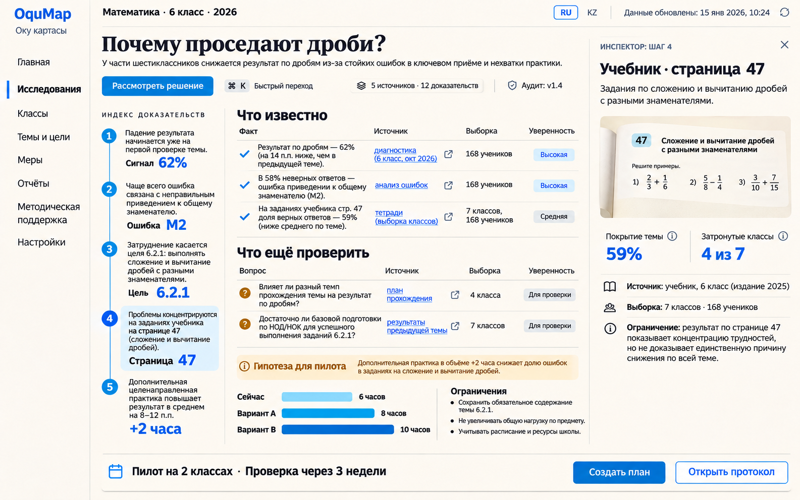
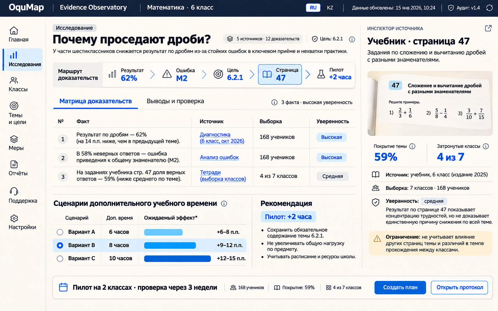
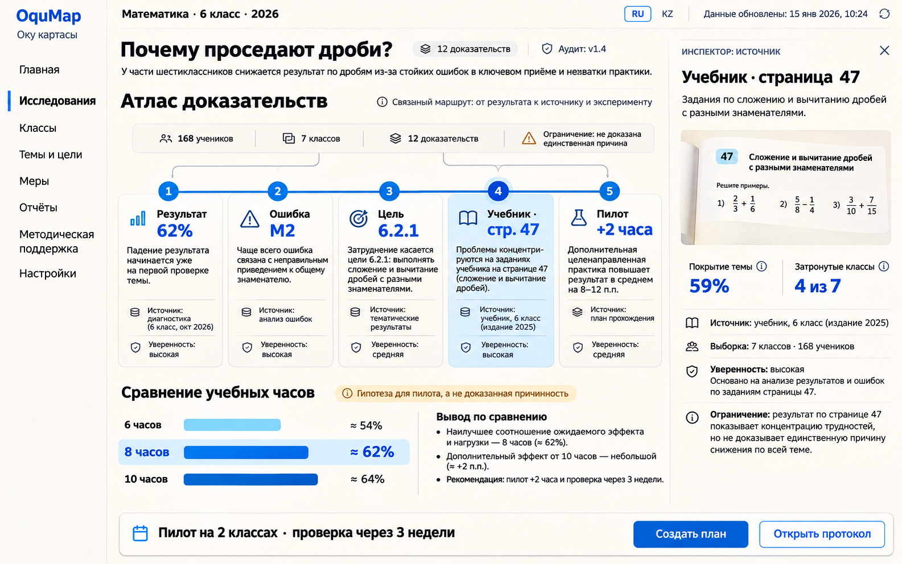

# OquMap — варианты Civic Humanist C3–C5

Дата: 2026-11-11 
Формат: desktop 16:10, 1585 × 992 
Базовая референсная версия: `oqumap-civic-humanist-c2-investigation.png`

Новые варианты не заменяют C2. Они проверяют три разных способа показать одну и ту же продуктовую историю: от результата тестирования к ошибке, цели программы, конкретной странице учебника и проверяемому пилоту.

## C3 — Editorial Evidence Ledger

**Сильная сторона:** самое премиальное и спокойное первое впечатление. Крупная редакционная типографика и вертикальный индекс доказательств создают ощущение серьёзного исследовательского инструмента.

**Риск:** центральная таблица и левый маршрут конкурируют за ширину; на небольших ноутбуках потребуется сворачиваемый индекс.

**Лучшее применение:** основной интерфейс исследования для методиста и визуальная основа бренд-системы.

## C4 — Evidence Observatory

**Сильная сторона:** наиболее сильный рабочий интерфейс. Горизонтальный маршрут быстро объясняет причинно-следственную цепочку, матрица доказательств хорошо поддерживает ежедневную аналитику, а тёмная командная полоса повышает контраст и собранность.

**Риск:** менее характерный и эмоциональный, чем C3 и C5; без аккуратной типографики может стать похожим на обычный enterprise-продукт.

**Лучшее применение:** production-основа для плотных аналитических экранов и режима экспертной проверки.

## C5 — Curriculum Atlas

**Сильная сторона:** лучше всего объясняет уникальную идею OquMap за 5–10 секунд. Пять станций образуют запоминаемую цепочку «результат → ошибка → цель → источник → эксперимент», причём каждый вывод остаётся проверяемым.

**Риск:** карточки станций занимают много места; для сложных кейсов атлас должен поддерживать сворачивание вторичных ветвей, иначе появится визуальный шум.

**Лучшее применение:** демо для жюри, режим обзора исследования, onboarding и скриншоты для README/презентации.

## Рекомендация

Не выбирать один макет целиком. Самая сильная финальная система:

1. **C2 как базовый каркас:** спокойная навигация, правый инспектор источника, нижняя панель решения.
2. **C3 для визуального языка:** редакционная иерархия, крупные заголовки, бумажный фон, вертикальный ритм, минимум декоративных контейнеров.
3. **C4 для экспертного режима:** матрица «Факт / Источник / Выборка / Уверенность», компактные статусы и плотная работа с доказательствами.
4. **C5 как фирменный режим «Атлас»:** главный экран исследования и кульминация трёхминутного демо.

Итоговая структура продукта должна иметь два представления одних и тех же данных:

- **«Атлас»** — быстро понять путь доказательств и провести презентацию;
- **«Матрица»** — проверить источники, выборки, уверенность и ограничения.

Переключение между ними не должно менять данные или решение: это разные способы чтения одной доказательной модели.

## Что переносить в реализацию

- единый синий маршрут доказательств и фиксированная семантика его пяти шагов;
- кликабельный шаг открывает правый инспектор, не уводя пользователя на другой экран;
- у каждого факта есть источник, выборка, уровень уверенности и ограничение;
- охра/янтарный цвет используется только для гипотез, ограничений и непроверенных связей;
- сценарии 6/8/10 часов явно маркируются как прогноз, а не доказанный причинный эффект;
- нижний dock всегда показывает следующий проверяемый шаг: пилот, выборку и срок проверки;
- RU/KZ должны использовать одинаковую геометрию компонентов и проверяться на переполнение;
- на 1280 px правый инспектор и индекс доказательств становятся сворачиваемыми, но маршрут и решение остаются видимыми.

## Происхождение макетов

Макеты созданы встроенной генерацией изображений в режиме reference/edit на основе C2; исходный C2 не изменён.

- C3 prompt focus: editorial evidence ledger, вертикальный индекс, премиальная типографика.
- C4 prompt focus: evidence observatory, горизонтальный маршрут, матрица доказательств.
- C5 prompt focus: curriculum atlas, пять читаемых станций, сильный demo moment.
