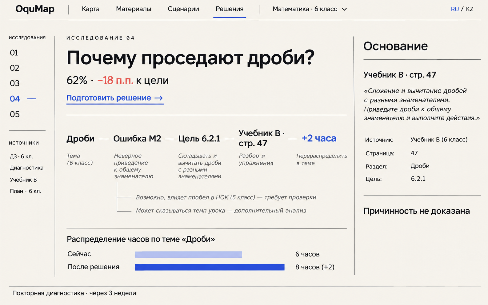
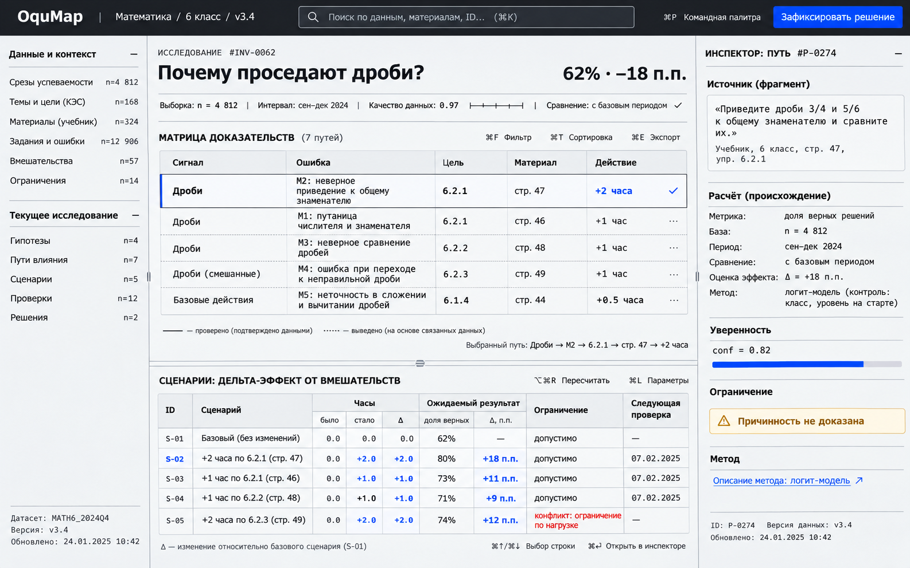
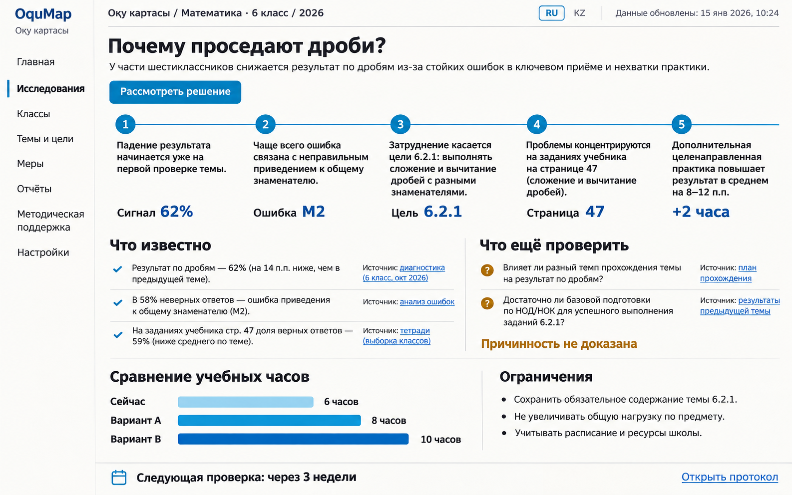
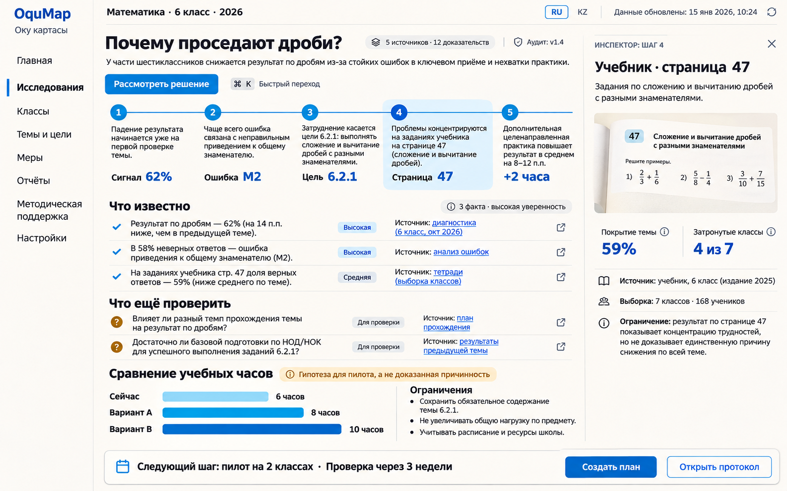
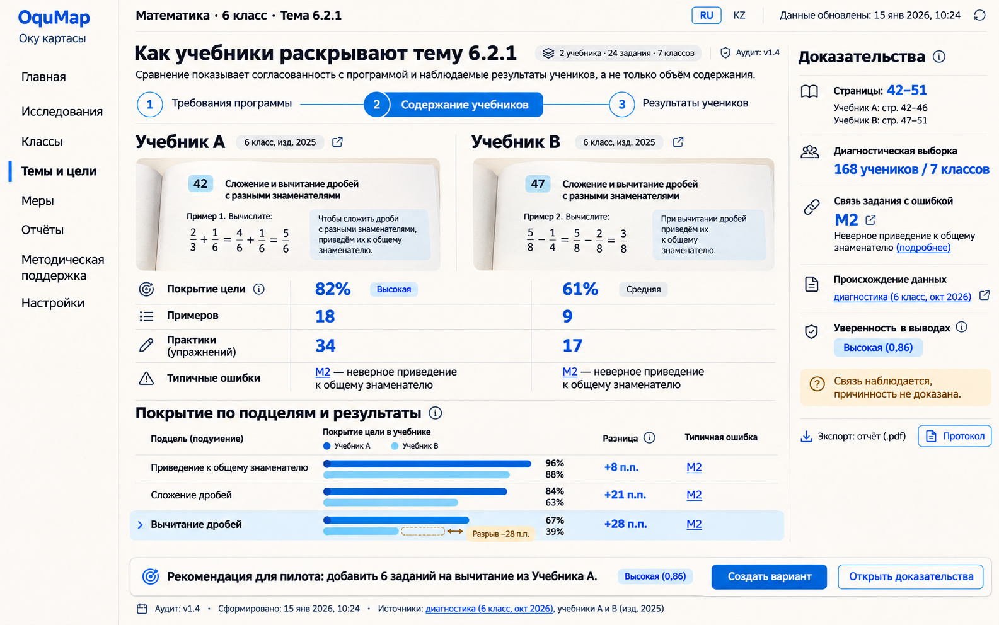

# OquMap — сравнение визуальных направлений

## Краткий вывод

Пользователь выбрал **C — Civic Humanist** как основное направление. Версия **C2** сохраняет его понятность, синие числовые акценты и спокойный светлый характер, но добавляет глубину рабочего инструмента:

- типографическую индивидуальность **A — Editorial Cartography**;
- контекстный inspector, provenance и ограничения из **B — Scientific Instrument**;
- оболочку, последовательность и projector readability **C — Civic Humanist**.

Рабочая спецификация и два экрана C2: [PRODUCT_ANALOGS_AND_C2_DIRECTION.md](./PRODUCT_ANALOGS_AND_C2_DIRECTION.md).

Основной продуктовый шрифт — **Onest 2.x Variable**. `Noto Sans` — fallback. Mono применяется только для технических ID и логов.

## A — Editorial Cartography

### Сильные стороны

- наиболее оригинальный и премиальный образ;
- продукт сразу отличается от типичного admin dashboard;
- прекрасная иерархия главного вопроса;
- метафора исследования/карты читается без декоративной графики;
- хорошо подходит для сквозной конкурсной демонстрации;
- Onest соответствует характеру направления.

### Риски

- на большом количестве данных может стать слишком editorial;
- верхняя текстовая навигация хуже масштабируется на 10+ разделов;
- правый источник нужно сделать интерактивным, а не статичной колонкой;
- italic в evidence notes следует использовать реже;
- bars внизу должны отражать ограничения, а не только длину.

### Prompt summary

Premium editorial research UI; Onest-like humanist typography; top text navigation; left investigation index; open evidence route; footnote-style source column; before/after hours strip; warm paper, ink and ultramarine; no cards, shadows, gradients or icon soup.

## B — Scientific Instrument

### Сильные стороны

- лучше всего показывает сложную аналитику;
- evidence matrix очень хорошо масштабируется;
- provenance, метод и ограничения находятся рядом с выводом;
- плотность высокая, но структура остаётся ясной;
- раздельные panes хорошо подходят для desktop;
- клавиатурная/command-palette модель естественна для power users.

### Риски

- может выглядеть слишком технически для части методистов;
- тёмная command bar создаёт более жёсткий образ;
- mono нужно ограничить ID и вычислениями;
- нельзя показывать прогноз эффекта без реальной валидированной модели;
- на проекторе потребуется presentation density mode.

### Prompt summary

Research-instrument UI; IBM-Plex-like technical typography; dark command bar; quiet data index; evidence matrix; calculation inspector; scenario delta table; compact grid, square radii and semantic cobalt; no tiles or conversational AI panel.

## C — Civic Humanist

### Выбранное развитие C2

### Сильные стороны

- наиболее понятен неподготовленному пользователю;
- сильная читаемость с проектора;
- plain-language evidence narrative;
- лучше всего подходит для директора, госзаказчика и презентации пилота;
- Source-Sans-подобная гуманистическая типографика хорошо работает в длинном тексте.

### Риски

- визуально менее уникален;
- numbered timeline может чрезмерно упрощать нелинейные связи;
- стандартная левая навигация делает продукт более обычным;
- большие пояснения занимают много места;
- с ростом функций существует риск превратиться в портал госуслуг.

### Prompt summary

Humanist civic-service UI; Source-Sans-like Cyrillic; light navigation; five-step evidence narrative; verified/unknown columns; plain-language hour comparison; Kazakhstan-inspired blue and ochre used sparingly; accessible, calm and projector-readable.

## Сравнительная матрица

Оценка 1–5 относится к направлению, а не к качеству сгенерированного текста.

| Критерий | A Editorial | B Scientific | C Civic |
|---|---:|---:|---:|
| Уникальность | 5 | 4 | 3 |
| Ежедневная аналитика | 3 | 5 | 3 |
| Понятность без обучения | 4 | 3 | 5 |
| Проектор/питч | 5 | 3 | 5 |
| Масштабирование функций | 3 | 5 | 4 |
| Доверие к доказательствам | 4 | 5 | 4 |
| RU/KZ friendliness | 5 | 4 | 5 |
| Риск AI/admin-template | 1 | 2 | 3 |

## Принятый синтез C2

### Shell

Сохранить оболочку C, но заменить типографику на Onest, усилить редакционную иерархию A и оставить вопрос главным объектом.

### Workbench

Взять B: контекстный inspector, provenance, ограничения, keyboard commands и компактные сравнения. Не переносить постоянную техническую плотность B.

### Presentation mode

Использовать тот же C2-интерфейс в презентационном режиме: последовательное раскрытие 1–5, plain language, крупные цифры, минимальное число контролов, RU/KZ-safe строки.

### Что не переносить

- декоративную верхнюю дату из генераций;
- любые неподтверждённые прогнозы прироста;
- длинный sidebar из C;
- постоянную тёмную панель из B, если она перетягивает внимание;
- italic как основной explanatory style из A;
- сгенерированные иконки и неточные формулировки.

## Следующий прототип после функционального merge

Собрать кодовый prototype одного маршрута:

1. shell и stepper C2;
2. evidence rows и comparison view C2;
3. inspector B в визуальном языке C2;
4. presentation mode C2;
5. Onest/Noto typography;
6. реальные данные текущего demo fixture;
7. keyboard/focus/reduced-motion;
8. screenshot QA на 1440×900, 1920×1080 и 1280×800.
